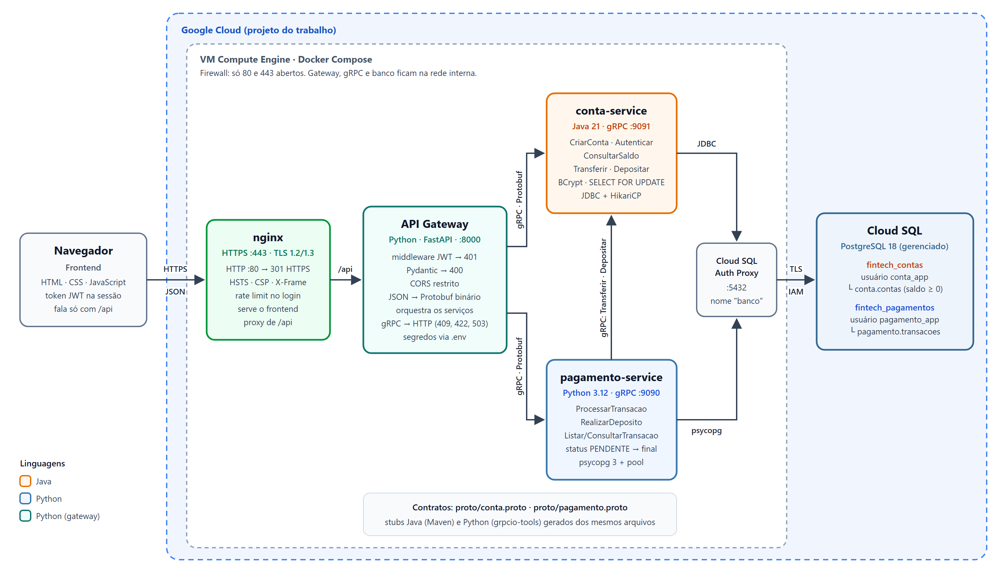
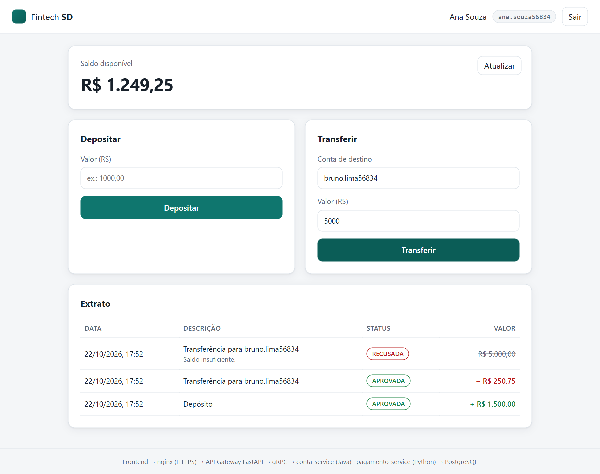

# Fintech SD — API Gateway, microsserviços gRPC e PostgreSQL

Trabalho 2 de Sistemas Distribuídos. É a evolução da fintech de pagamentos do
[Trabalho 1](https://github.com/henryengels/Trabalho1-sd), que tinha dois serviços Java com gRPC, saldos
em memória e um cliente de terminal. Agora o sistema tem:

- **Frontend web** (HTML, CSS e JavaScript) servido por **nginx com HTTPS**.
- **API Gateway em FastAPI**: ponto único de entrada, com autenticação **JWT**, validação **Pydantic** e
  **CORS** restrito. Ele traduz JSON em chamadas **gRPC/Protobuf**.
- **Dois microsserviços gRPC em linguagens diferentes**, falando entre si pelos mesmos contratos `.proto`:
  - `conta-service` em **Java 21**: contas, credenciais e saldos.
  - `pagamento-service` em **Python 3.12**: registro e histórico das transações.
- **PostgreSQL 18** como banco real, com um banco por microsserviço. Em produção é o **Cloud SQL**
  (Google Cloud), acessado pelo Cloud SQL Auth Proxy.

**Equipe:** Henry Engels de Aguiar, Paulo Francisco Oliveira Teles e Matheus Santana de Moura.

Repositório: <https://github.com/henryengels/Trabalho2-sd> · Apresentação: [docs/apresentacao.pdf](docs/apresentacao.pdf)

## Arquitetura



| Componente          | Tecnologia                                   | Porta (interna) | Responsabilidade                                                              |
|---------------------|----------------------------------------------|-----------------|-------------------------------------------------------------------------------|
| `frontend`          | HTML, CSS, JavaScript                        | —               | Telas de login, cadastro, saldo, depósito, transferência e extrato            |
| `nginx`             | nginx 1.27                                   | **80, 443**     | HTTPS, cabeçalhos de segurança, rate limit, arquivos do frontend, proxy de `/api` |
| `api-gateway`       | Python 3.12, FastAPI, PyJWT, grpcio (aio)    | 8000            | Valida, autentica, traduz JSON ↔ Protobuf e orquestra os serviços             |
| `conta-service`     | Java 21, grpc-java, JDBC, HikariCP, BCrypt   | 9091            | Dono das contas: cadastro, login, saldo, transferência e depósito             |
| `pagamento-service` | Python 3.12, grpcio, psycopg 3               | 9090            | Dono das transações: registra, delega ao conta-service e lista o extrato      |
| `cloud-sql-proxy`   | Cloud SQL Auth Proxy 2.14                    | 5432            | Túnel TLS autenticado por IAM até o Cloud SQL (perfil `gcp`)                  |
| `postgres`          | PostgreSQL 18                                | 5432            | Servidor em contêiner para desenvolvimento (perfil `local`)                   |
| `preparar-banco`    | psql (tarefa única)                          | —               | Cria os bancos e usuários de cada microsserviço antes de eles iniciarem       |

Somente o nginx publica portas para a rede. O gateway, os serviços gRPC e o banco ficam na rede interna
do Docker Compose, então o navegador só alcança os microsserviços passando pelo gateway. No perfil
`local`, o PostgreSQL também fica acessível em `127.0.0.1:15432` (apenas na própria máquina), para
ferramentas como o DBeaver.



### Fluxo de uma transferência

1. O frontend envia `POST /api/transacoes/transferencia` com `{"conta_destino": "bruno", "valor": 150.50}`
   e o cabeçalho `Authorization: Bearer <token>`.
2. O nginx termina o TLS e encaminha a requisição ao gateway.
3. O middleware JWT do gateway valida assinatura, emissor e expiração. Sem token válido, responde **401**
   ali mesmo.
4. O Pydantic valida o corpo: campos obrigatórios, formato da conta, valor positivo com até 2 casas e
   nenhum campo extra. Se algo falhar, a resposta é **400**.
5. O gateway monta um `ProcessarTransacaoRequest` (Protobuf). A conta de origem vem do token, nunca do
   corpo. A mensagem segue por gRPC ao `pagamento-service` (Python).
6. O `pagamento-service` grava a transação como `PENDENTE` e chama `ContaService.Transferir` por gRPC no
   `conta-service` (Java).
7. O `conta-service` abre uma transação no seu banco (`fintech_contas`). Bloqueia as duas contas (`SELECT ... FOR UPDATE`),
   valida existência e saldo, debita, credita e faz commit.
8. O `pagamento-service` atualiza a transação para `APROVADA` ou `RECUSADA` e responde ao gateway.
9. O gateway converte a resposta em JSON: **201 Created**, ou **422** quando a regra de negócio recusou
   (saldo insuficiente, destino inexistente).

## API REST do gateway

Documentação interativa (Swagger): `https://<host>/api/docs`.

| Método | Rota                             | Token | Chamadas gRPC                                                   | Sucesso | Erros               |
|--------|----------------------------------|-------|-----------------------------------------------------------------|---------|---------------------|
| GET    | `/api/saude`                     | não   | —                                                               | 200     |                     |
| POST   | `/api/auth/registro`             | não   | `ContaService.CriarConta`                                       | **201** | 400, 409            |
| POST   | `/api/auth/login`                | não   | `ContaService.Autenticar`, depois o gateway emite o JWT         | 200     | 400, 401            |
| GET    | `/api/contas/me`                 | sim   | `ContaService.ConsultarSaldo`                                   | 200     | 401                 |
| GET    | `/api/contas/me/extrato?limite=` | sim   | `ConsultarSaldo` (Java) e `ListarTransacoes` (Python) em paralelo | 200     | 400, 401            |
| POST   | `/api/transacoes/deposito`       | sim   | `PagamentoService.RealizarDeposito` → `ContaService.Depositar`  | **201** | 400, 401, 409, 503  |
| POST   | `/api/transacoes/transferencia`  | sim   | `PagamentoService.ProcessarTransacao` → `ContaService.Transferir` | **201** | 400, 401, 409, 422, 503 |
| GET    | `/api/transacoes/{id}`           | sim   | `PagamentoService.ConsultarTransacao` (comprovante)             | 200     | 400, 401, 404       |

As respostas **201** trazem o cabeçalho `Location` com o endereço do recurso criado: `/api/contas/me` no
cadastro e `/api/transacoes/{id}` (o comprovante) no depósito e na transferência.

Significado dos status:

| Status                      | Quando                                                                                       |
|-----------------------------|----------------------------------------------------------------------------------------------|
| 200 OK / 201 Created        | Consulta ou login bem-sucedidos / conta, depósito ou transferência criados                   |
| 400 Bad Request             | JSON malformado, campo ausente, tipo ou formato inválido, campo desconhecido, transferência para a própria conta |
| 401 Unauthorized            | Token ausente, inválido ou expirado (barrado no middleware) ou login com senha errada        |
| 404 Not Found               | Transação inexistente ou de outra conta (comprovante)                                        |
| 409 Conflict                | Cadastro com conta já existente, ou conta ocupada por outra operação além de 2 s (nada é gravado; pode repetir) |
| 422 Unprocessable Entity    | Transação válida recusada pela regra de negócio (fica registrada como `RECUSADA`)            |
| 429 Too Many Requests       | Limite de requisições do nginx excedido                                                      |
| 503 Service Unavailable     | Um microsserviço não respondeu no prazo                                                      |

Exemplo de erro 400:

```json
{
  "detail": "Dados inválidos.",
  "erros": [
    {"campo": "valor", "mensagem": "Use no máximo 2 casas decimais."},
    {"campo": "conta_destino", "mensagem": "Campo obrigatório."}
  ]
}
```

## Contratos gRPC

Os contratos ficam em [`proto/`](proto) e são a fonte única dos dois lados. O módulo Maven
`contratos-grpc` gera as classes Java. Os Dockerfiles do gateway e do `pagamento-service` geram os stubs
Python com `grpcio-tools`. Como as mensagens trafegam em Protobuf binário, Python e Java conversam sem
nenhuma camada extra.

| Serviço (linguagem)           | RPC                  | Chamado por                       |
|-------------------------------|----------------------|-----------------------------------|
| `ContaService` (Java)         | `CriarConta`         | gateway                           |
|                               | `Autenticar`         | gateway                           |
|                               | `ConsultarSaldo`     | gateway                           |
|                               | `Transferir`         | pagamento-service                 |
|                               | `Depositar`          | pagamento-service                 |
| `PagamentoService` (Python)   | `ProcessarTransacao` | gateway                           |
|                               | `RealizarDeposito`   | gateway                           |
|                               | `ListarTransacoes`   | gateway                           |
|                               | `ConsultarTransacao` | gateway                           |

Valores monetários trafegam em centavos (`int64`), como no Trabalho 1, para evitar erros de
arredondamento. Erros usam os códigos padrão do gRPC (`INVALID_ARGUMENT`, `ALREADY_EXISTS`,
`UNAUTHENTICATED`, `ABORTED`, `UNAVAILABLE`...), e o gateway os traduz para HTTP.

## Banco de dados

PostgreSQL 18 foi escolhido por ser relacional e transacional (ACID). Numa fintech, débito e crédito
precisam acontecer juntos ou não acontecer, e restrições como saldo não negativo devem ser garantidas pelo
próprio banco. Em produção o servidor é uma instância gerenciada do **Cloud SQL**.

Cada microsserviço tem **o próprio banco e o próprio usuário** (padrão *database-per-service*), na mesma
instância PostgreSQL:

| Banco                | Usuário         | Microsserviço       | Tabela                 | Conteúdo                                                                   |
|----------------------|-----------------|---------------------|------------------------|----------------------------------------------------------------------------|
| `fintech_contas`     | `conta_app`     | `conta-service`     | `conta.contas`         | `id`, `titular`, `senha_hash` (BCrypt), `saldo_centavos` (`CHECK >= 0`), `criada_em` |
| `fintech_pagamentos` | `pagamento_app` | `pagamento-service` | `pagamento.transacoes` | `id` (UUID), `tipo`, `conta_origem`, `conta_destino`, `valor_centavos`, `status`, `mensagem`, datas |

- O contêiner `preparar-banco` roda [banco/preparar-bancos.sql](banco/preparar-bancos.sql) com o usuário
  administrador `postgres` antes de os serviços iniciarem. Ele cria os dois bancos e usuários se ainda não
  existirem e retira o acesso público. O resultado é que `pagamento_app` não consegue nem se conectar a
  `fintech_contas`, e vice-versa. Os usuários das aplicações não são administradores.
- As tabelas são criadas pelo próprio serviço na inicialização (`CREATE ... IF NOT EXISTS`).
- Um serviço só obtém dados do outro pela API gRPC, nunca lendo o banco alheio.

Todas as consultas, inserções e alterações vão ao banco. Não há listas em memória, dados fixos nem
respostas simuladas. A transferência usa `SELECT ... FOR UPDATE` com as contas sempre bloqueadas na mesma
ordem, o que evita saldo lido em duplicidade e deadlocks. Num teste com 20 transferências simultâneas de
R$ 100,00 a partir de um saldo de R$ 849,50, exatamente 8 foram aprovadas, 12 recusadas, e a soma dos
saldos no banco permaneceu a mesma.

Proteções contra operações presas:

- **`lock_timeout` de 2 s e `statement_timeout` de 5 s** em todas as conexões dos dois serviços. Sem esses
  limites, o PostgreSQL esperaria para sempre por uma conta bloqueada, prendendo threads e conexões do
  pool. Quando um limite estoura, o banco faz rollback e o cliente recebe **409** "Conta ocupada por outra
  operação; tente novamente".
- **Prazo conferido antes do commit.** O `conta-service` recebe o prazo da chamada gRPC. Se o
  `pagamento-service` já desistiu quando a transferência ou o depósito chega ao commit, a operação é
  desfeita, em vez de mover dinheiro que o histórico registrou como `FALHA`.

## Segurança

- **HTTPS no nginx**: TLS 1.2/1.3, redirecionamento 80 → 443 e certificado gerado na inicialização para o
  IP ou domínio configurado (pode ser substituído por um certificado de autoridade certificadora).
- **Cabeçalhos**: HSTS, `Content-Security-Policy` (somente a própria origem), `X-Frame-Options: DENY`,
  `X-Content-Type-Options`, `Referrer-Policy`.
- **Rate limit** no nginx (30 requisições/min por IP em `/api/auth/`) e limite de 16 KB no corpo.
- **JWT (HS256)** emitido no login e validado por um middleware do gateway em todas as rotas, exceto
  cadastro, login, saúde e documentação. Algoritmo fixo, emissor e expiração obrigatórios.
- **Autorização**: a conta de origem das operações vem do token, então nenhum usuário movimenta a conta de
  outro. Informar `conta_origem` no corpo gera 400.
- **Validação Pydantic** com `extra="forbid"`, padrões de formato e limites de tamanho e valor. Os serviços
  revalidam as entradas (defesa em profundidade).
- **CORS** restrito às origens listadas em `CORS_ORIGENS`, sem curinga.
- **Segredos** (`JWT_SEGREDO` e senhas do banco) apenas no `.env`, que está no `.gitignore` e no `.dockerignore`.
  O gateway recusa iniciar sem um segredo JWT de pelo menos 32 caracteres.
- **Senhas** guardadas com BCrypt. O login responde no mesmo tempo para conta inexistente e para senha
  errada.
- **Banco por serviço**: cada microsserviço usa um usuário sem privilégios de administrador que só tem
  acesso ao próprio banco.
- **SQL parametrizado** em Java (`PreparedStatement`) e Python (`%s` do psycopg).
- **Rede interna**: só 80/443 são publicados para a rede. No perfil `local`, o PostgreSQL fica em
  `127.0.0.1`, inacessível a outros computadores. O banco no Google Cloud é acessado pelo Cloud SQL Auth
  Proxy (TLS + IAM), sem IP liberado na instância.
- **Contêineres sem root** (gateway, serviços Java e Python).

## Estrutura do repositório

```text
proto/                    contratos gRPC (conta.proto, pagamento.proto)
contratos-grpc/           módulo Maven que gera as classes Java dos contratos
conta-service/            microsserviço Java (gRPC + JDBC) e Dockerfile
pagamento-service/        microsserviço Python (gRPC + psycopg) e Dockerfile
api-gateway/              API Gateway FastAPI e Dockerfile
banco/                    script que cria os bancos e usuários de cada microsserviço
frontend/                 interface web (index.html, estilos.css, app.js)
nginx/                    configuração do proxy HTTPS, snippets e geração do certificado
scripts/testar-api.sh     teste de ponta a ponta da API (status HTTP esperados)
docs/                     guias de execução, diagrama, apresentação e coleção do Postman
docker-compose.yml        orquestração dos contêineres (perfis local e gcp)
.env.example              modelo das variáveis de ambiente e segredos
pom.xml, mvnw             build Maven da parte Java
```

## Como executar

### Na máquina local (Docker Desktop)

```bash
cp .env.example .env               # PowerShell: Copy-Item .env.example .env
# edite o .env: preencha DB_ADMIN_SENHA, DB_CONTAS_SENHA, DB_PAGAMENTOS_SENHA e JWT_SEGREDO
# (para gerar valores: python -c "import secrets; print(secrets.token_urlsafe(48))")
docker compose up -d --build
```

Abra <https://localhost> e aceite o aviso do certificado autoassinado. O passo a passo completo, com
consultas ao banco e solução de problemas, está em [docs/guia-execucao.md](docs/guia-execucao.md).

### No Google Cloud (Cloud SQL + VM)

Resumo: criar a instância Cloud SQL PostgreSQL 18, dar o papel *Cloud SQL Client* à service account da
VM, criar a VM com Docker, preencher o `.env` com `COMPOSE_PROFILES=gcp` e subir com
`docker compose up -d --build`. Os bancos e usuários são criados automaticamente pelo `preparar-banco`. Os comandos completos estão em [docs/gcp.md](docs/gcp.md).

### Teste de ponta a ponta

```bash
bash scripts/testar-api.sh https://localhost     # ou https://IP_DA_VM
```

O script cria contas novas e faz 26 verificações: 401 sem token, 400 para dados inválidos e JSON
malformado, 201 em cadastro, depósito e transferência, o cabeçalho `Location`, 404 para comprovante
inexistente, 409 para conta duplicada, 422 para saldo insuficiente e 200 nas consultas.

Também é possível testar pelo **Swagger** (`https://<host>/api/docs`) ou pelo **Postman/Insomnia**,
importando [docs/postman/Fintech-SD.postman_collection.json](docs/postman/Fintech-SD.postman_collection.json).
O passo a passo está na seção 5 de [docs/guia-execucao.md](docs/guia-execucao.md).

## Limitações conhecidas

- O certificado HTTPS é autoassinado. Com um domínio próprio, basta montar um certificado válido em
  `/etc/nginx/certs` (ver [docs/gcp.md](docs/gcp.md)).
- O tráfego gRPC interno não usa TLS porque fica restrito à rede privada do Docker na VM.
- Uma transação marcada como `FALHA` (o conta-service não respondeu a tempo) não é repetida
  automaticamente, para evitar débito duplicado. O conta-service desfaz a operação se o prazo acabar antes
  do commit, mas ainda há uma janela pequena: o commit terminar e a resposta se perder na rede.
- O JWT não tem renovação (refresh token) nem lista de revogação: o usuário entra de novo quando o token
  expira (30 minutos por padrão).
